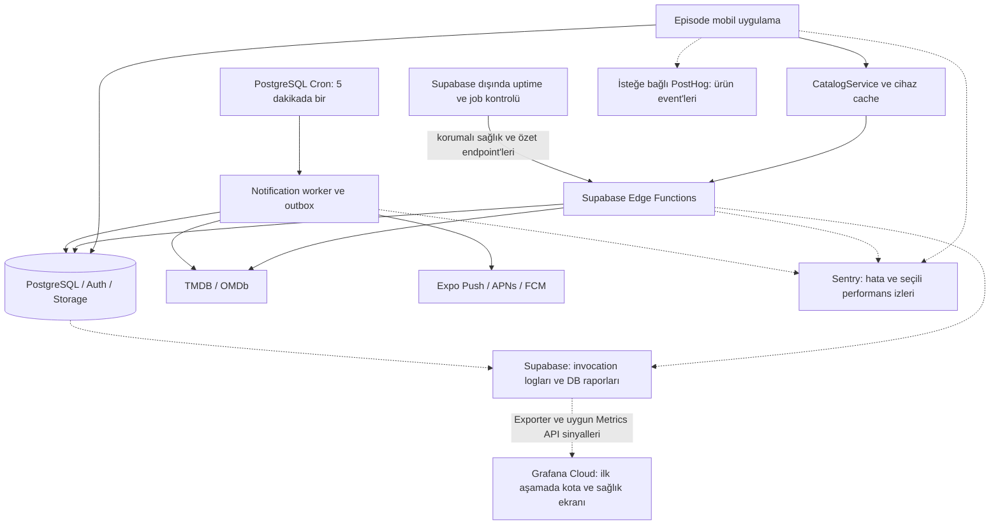

# Episode için monitoring mimarisi ve karar rehberi

Tarih: 2 Kasım 2026. Durum: mimari önerisi; uygulamaya entegre edilmedi, servis hesabı açılmadı, yayın yapılmadı. Kullanıcının sonraki tercihiyle Grafana Cloud + yerel Docker kapsamı ve dashboard taslağı [Grafana uygulama planında](monitoring-grafana-plan.md) somutlaştırıldı.

Bu tasarım repository incelemesine dayanır. Kullanıcı uygulamanın mağazada olduğunu ve günlük yaklaşık 7–8 kişinin kullandığını belirtti. Canlı Supabase, Sentry, Expo ve mağaza hesapları incelenmedi; gerçek gecikmeler, hesaplara özel kotalar ve faturalar bilinmiyor. Aşağıdaki eşikler başlangıç önerileridir, ölçüm sonucu veya hizmet garantisi değildir.

## 1. Benim önerim

Güncel uygulama durumu: Backend ve temel mobil JS analitiği kodlandı; canlıya yayımlanmadı. Grafana hesabı hazır olduğunda bağlantı ve backend dağıtımı [kurulum rehberine](monitoring-setup.md) göre yapılacak. Bu belgedeki genel hedeflerin tamamı uygulanmış sayılmaz.

Episode için temel monitoring gerekli. En büyük faydası kullanıcı söylemeden çökme, sunucuya ulaşmayan değişiklik, bildirim aksaması ve API kotası sorununu fark etmek olur. Kullanıcının görsel panel ve DevOps öğrenme tercihiyle ilk kapsam Grafana Cloud + Loki + Tempo + yerel Docker laboratuvarı olarak güncellendi. Supabase verileri otomatik exporter ile paneli besleyecek; Sentry/native mobil kapsam sonraki açıkça istenen build'e biriktirilecek. Bağımsız uptime/heartbeat kontrolü korunur.

Kullanıcının sonraki isteğiyle temel kullanıcı sayısı ve aktivite takibi ilk kapsama alındı: kayıtlı/yeni hesap, DAU/WAU/MAU, ürün oturumu ve anlamlı özellik kullanımı aynı Grafana ortamında gösterilecek. Ayrıntılı funnel/retention ve PostHog ayrı bir karar olarak kalır. Session replay, sürekli cihaz profillemesi ve her dokunuşu toplama başlangıç için öncelikli değil. Küçük kullanıcı sayısı Grafana/Loki/Tempo öğrenme hedefini geçersiz kılmaz; üretimde managed Cloud, yerelde öğrenme ortamı tercih edilir.

| Paket | İçerik | Kararım |
| --- | --- | --- |
| Temel sağlık ve görsel panel | Grafana'da kota/tüketim, backend sağlık, Loki/Tempo, bağımsız kontrol; mobil kapsam build ile | İlk uygulanacak kapsam |
| Temel kullanıcı/aktivite | Hesap sayısı, DAU/WAU/MAU, ürün oturumu ve özellik sayıları | Kullanıcının isteğiyle ilk kapsamda |
| Ayrıntılı ürün analitiği | Aktivasyon funnel'ı, D1/D7 tutunma ve deneyler | Bu verilere göre ürün kararı alınacaksa ekle |
| Gelişmiş teşhis | Seçili profiling, ücretsiz retention dışındaki uzun geçmiş, gerekirse maskeli replay | Gerçek bir teşhis veya ölçek ihtiyacı oluştuğunda ekle |

Tam native hata takibini bir sonraki kullanıcı tarafından açıkça istenen native build'e dahil ederim. Backend gözlemlenebilirliği daha önce kurulabilir. Yeni build veya OTA yayını bu belgenin kapsamı değildir.

## 2. Mevcut projede bulunanlar ve eksikler

| Alan | Kodda bulunan | Eksik veya dikkat edilmesi gereken |
| --- | --- | --- |
| Mobil | Expo Router, React Query, Zustand, `expo-updates` | `package.json` içinde Sentry/PostHog yok; merkezi mobil hata ve performans bildirimi görülmedi |
| Katalog | `src/services/tmdb.ts`, `RequestCache`, Supabase `catalog-api` | Kullanıcıya içerik gösterme süresi, cihaz cache'i ve sunucu cache'i birlikte ölçülmüyor |
| Dış servis | `external_api_usage_daily` ve `external_api_cache` | Günlük toplamlar var; istek bazında gecikme ve eksiksiz hata paydası yok |
| Cache | `HIT`, `MISS`, `STALE-LIMIT`, `STALE-ERROR` yanıt header'ı | HTTP 200, güncel veri veya sağlıklı upstream anlamına gelmiyor |
| Sync | Kalıcı değişiklik günlüğü, sürüm bazında onay, seri yazma, retry | Bekleyen en eski değişikliğin yaşı, onay gecikmesi ve kalıcı hata oranı izlenmiyor |
| Bildirim | Beş dakikalık Cron, `episode_sync_state`, transactional outbox, Expo ticket/receipt | Bağımsız heartbeat, kuyruk yaşı ve uçtan uca teslim görünümü yok |
| CI/CD | Yerel testler, performans regresyon testleri, deployment kontrolleri | Üretimdeki yeni release/OTA'nın kullanıcı etkisini ölçen karşılaştırma yok |
| Ortamlar | `preview` ve `production` kanalları | Proje rehberine göre aynı Supabase projesini kullanıyorlar; mobil kanal ayrımı backend izolasyonu sağlamıyor |

Ölçüm eklenirken şu boşluklar özellikle kapatılmalı:

1. `catalog-api` içindeki `error_count` yalnızca stale kayıtla karşılanan bazı upstream hatalarında artırılıyor. Stale kayıt bulunmadan dönen 502 dahil tüm hataları kapsayan bir sayaç değil.
2. Bildirim worker'ı TMDB'ye doğrudan gidiyor. Katalog tablosundaki TMDB tüketimi bütün uygulamanın toplam tüketimi olarak sunulmamalı.
3. OMDb `request_count` atomik kota rezervasyonuyla artıyor. Bunun adı ve yorumu sağlayıcının teyit ettiği faturalandırılmış istek sayısından ayrılmalı.
4. `RequestCache` eski veriyi döndürdüğünde veya cache yazımı başarısızlığını yuttuğunda işlem kullanıcıya başarılı görünebilir. Bu davranış korunurken sonuç `degraded` veya `cache_write_failed` olarak ölçülmeli.
5. Worker `scanErrors > 0` olsa da HTTP 200 dönebiliyor. Çalışmanın tamamlanması ile tüm taramaların başarılı olması ayrı sinyaller olmalı.
6. `notification_deliveries` tablosunda `created_at` yok. Gerçek kuyruk bekleme süresi için `enqueued_at` eklenmeli; o zamana kadar `notifications.created_at` ancak açıkça etiketlenmiş bir yaklaşık değer verir. Değişen `next_attempt_at`, ilk kuyruğa giriş zamanı değildir.
7. Jest performans testleri yararlı regresyon kontrolleridir; telefondaki açılış, kaydırma, bellek ve ağ deneyimini ölçmez.

## 3. Hedef veri akışı



Metrik sayısal eğilimi gösterir; log tek olayı açıklar; trace bir işlemin hangi adımda yavaşladığını gösterir. Örneğin detay ekranının 2,4 saniyesinin 1,8 saniyesi TMDB, 300 ms'si DB ve kalanı render/ağ olabilir. Bunlar örnek değerlerdir.

Monitoring hatası kullanıcının asıl işlemini durdurmamalı. Telemetri gönderimi zaman aşımı, sınırlı kuyruk ve sınırlı retry ile yapılmalı. İşlem sonucunu bekletmemeli; Edge runtime kapanmadan hata gönderimi için kontrollü flush uygulanmalı. Bu maliyet de ölçülmeli.

## 4. Toplanacak mobil sağlık ve performans metrikleri

Öncelik: **P0** temel paket, **P1** ilk verilerden sonra, **P2** ihtiyaç halinde. Her metrik ayrı SaaS ürünü gerektirmez.

| Metrik | Tam olarak neyi ölçer? | Ne karar aldırır? | Öncelik / kaynak |
| --- | --- | --- | --- |
| Crash-free session | `1 - en az bir fatal hata yaşayan session / ölçülebilen session` | Yeni sürüm kullanıcıyı uygulamadan düşürüyor mu? | P0 / native Sentry + session takibi |
| Fatal ve handled hata | Hata grubu, ilk/son görülme, etkilenen session/kullanıcı, ekran, sürüm | En fazla kullanıcıyı etkileyen hata önce çözülür | P0 / Sentry |
| Cold/warm startup | Native başlangıçtan ilk ekrana; soğuk başlangıç ile geri dönüş ayrı | Açılışta auth, font, hydration veya JS maliyeti artıyor mu? | P0 / SDK'nın desteklediği native ölçüm |
| İlk kullanılabilir içerik | Başlatma/navigasyondan ana içeriğin kullanılabilir olmasına | Splash'ın kapanması ile gerçekten hazır olmayı ayırır | P0 / uygulamaya özel hazır işareti |
| Ekran hazır olma süresi | Ana sayfa, keşfet, arama, detay, kütüphane, bildirim için p50/p95 | Hangi akış kullanıcıya yavaş geliyor? | P0 / manuel işaret + trace |
| Arama sonucu süresi | Kullanıcı son yazımından güncel sonuçların görünmesine | Debounce, network ve render ayrı iyileştirilebilir | P0 / uygulama ölçümü |
| Boş/hatalı/başarılı ekran | Ekran açılışının son durumu; meşru boş kütüphane ayrıca sınıflanır | Hızlı yanıtın gerçekte işe yarayıp yaramadığı anlaşılır | P0 / uygulama ölçümü |
| JS/UI takılmaları | JS stall ile native slow/frozen frame ayrı; platform desteği belirtilir | Listeler, blur, görseller veya animasyonlar sorunlu mu? | P1 / SDK + cihaz profillemesi |
| Poster/görsel performansı | Görsel yükleme süresi, hata, görünen ilk görsel | API hızlıyken ekran neden eksik görünüyor? | P1 / image lifecycle |
| Bellek/OOM/ANR/hang | Platformun gerçekten raporlayabildiği bellek baskısı ve yanıt vermeme | Uzun kullanımda kapanma/donma var mı? | P1 / native ve mağaza tanılama |
| CPU, enerji, ayrıntılı heap | Seçili sorun senaryolarında cihaz kaynak tüketimi | Belirli bir sızıntı/ısınma sorununun nedeni | P2 / Instruments ve Android profilleme |

`p95 = 2 saniye`, gözlenen işlemlerin %95'inin 2 saniye içinde tamamlandığı anlamına gelir. Ortalama tek başına kullanılmamalı. Farklı grupların p95 değerlerinin ortalaması alınmamalı; uyumlu histogramlar veya ham gözlemler birleştirilmeli.

Aramanın mevcut 450 ms debounce süresi kullanıcı tarafından hissedilen toplam süreye dahildir. Ayrıca debounce sonrası istek ve render süreleri ayrı ölçülmeli. İptal edilen/eski aramalar hata sayılmamalı; ham arama metni kaydedilmemeli.

JS başlangıcına konan bir kronometre native cold start'ı ölçmez. Sadece component mount'u da ekranın hazır olduğu anlamına gelmez. SDK/OS desteği doğrulanmayan OOM, hang veya frame ölçümü dashboard'da varmış gibi gösterilmemeli. JS ve UI thread ayrımı ile release modunda cihaz testi [React Native performans rehberinde](https://reactnative.dev/docs/performance/) açıklanıyor.

## 5. API, cache, kota ve veritabanı metrikleri

| Metrik | Ölçüm tanımı | Öncelik |
| --- | --- | --- |
| İstek hacmi ve sonuç | Endpoint şablonu, servis, sonuç sınıfı, HTTP durumuyla toplam istek | P0 |
| Mobil ağ gecikmesi | İstemcinin gönderimden yanıta süresi; uygulama timeout'u ayrıca | P0 |
| Edge gecikmesi | Gateway invocation ve handler süreleri; istemcinin ağ süresinden ayrı | P0 |
| Upstream gecikmesi | TMDB/OMDb için fetch süresi, timeout, 429, 5xx ve yanıtın anlamsal başarısı | P0 |
| HTTP 200 içindeki hata | Örneğin OMDb `Response: False`; bulunamama ve sağlayıcı arızası ayrı | P0 |
| Mantıksal işlem başarısı | Retry'lardan sonra kullanıcı işlemi başarı/başarısız/degraded mi? | P0 |
| Cihaz cache sonucu | Bellek, disk, miss, stale, in-flight birleştirme; katman bazında | P0 |
| Sunucu cache sonucu | `HIT/MISS/STALE-LIMIT/STALE-ERROR`; her biri için oran ve gecikme | P0 |
| Veri yaşı | Sunulan kaydın yaşı ve katalog kategorisinin tazelik bütçesi | P0 |
| Dış servis tüketimi | Katalog ve worker kaynakları dahil gerçek çağrı denemeleri | P0 |
| OMDb kota riski | Rezervasyon, kalan güvenlik bütçesi, tüketim hızı, gün sonu tahmini | P0 |
| Cache yazma/okuma sorunu | Başarısız erişim/yazım ve prune hatası; asıl istekten ayrı | P1 |
| DB kapasitesi | CPU, bellek baskısı, disk, bağlantı/pool doluluk ve bekleme | P0 |
| DB sorgu sağlığı | Yavaş sorgular, toplam sorgu maliyeti, lock/deadlock, timeout | P0 |
| Storage/Auth/egress | Dosya işlem hataları, token yenileme hataları, bant genişliği/kota | P0 |
| Cache büyümesi | Kayıt sayısı, boyut, eskimiş kayıt/prune ve DB yazma maliyeti | P1 |

İki ayrı başarı görünümü tutulmalı: kullanıcıya geçerli içerik sunuldu mu ve içerik yeterince güncel mi? `STALE-ERROR` ilkine başarılı, ikincisine bozulmuş kalite olarak yansıyabilir. Her stale kayıt her kategoride kötü değildir; IMDb puanı ile yeni bölüm takviminin tazelik ihtiyacı farklıdır.

Auth'ta yanlış parola, kullanıcının iptali veya verilmemiş bildirim izni beklenen ürün sonuçlarıdır; sunucu arızasıyla aynı hata grubuna konmamalı. Beklenmedik token yenileme, RLS reddi veya ani başarısızlık artışı ayrıca incelenir. Hesap silmede Auth, Storage ve DB adımlarının sonucu içerik kaydetmeden takip edilmeli.

Cache hit oranının paydası açık olmalı: `fresh / (fresh + miss + stale)`. Mevcut günlük sayaçlarda dalların kapsamı eşitlenmeden bu formülü doğrudan uygulayıp kesin oran üretmemeliyiz. Aynı isteğin hem stale hem upstream denemesi sayıldığı sayaçlar basitçe toplanamaz. Cihaz ve sunucu cache oranları da birbiriyle karıştırılmamalı.

OMDb için kodun güvenlik limiti 950/gün. Bu, satın alınan planın canlı doğrulaması değildir. Başlangıç uyarısı 700 rezervasyon/gün, kritik uyarı 850 olabilir; ayrıca kalan süreye göre tüketim tahmini gerekir. Gün sınırı DB'deki `current_date` davranışı ve sağlayıcının sıfırlama zamanı doğrulanarak etiketlenmeli; İstanbul gece yarısı varsayılmamalı.

Supabase'in yerleşik raporları ilk aşamada kullanılabilir. Uzun dönem merkezi metrik ihtiyacında resmi [Metrics API](https://supabase.com/docs/guides/observability/metrics), Prometheus uyumlu DB metriklerini Grafana Cloud gibi bir sisteme aktarabilir. Bu API bütün mobil ve özel iş metriklerini kendiliğinden sağlamaz; beta metrik isimleri/sözleşmesi entegrasyonda doğrulanmalı.

## 6. Episode için kritik sync metrikleri

Bu uygulamada kullanıcı izlediği bölümleri işaretliyor ve kütüphanesini yönetiyor. Bir işlemin cihazda görünmesi, başka cihazda da kalıcı olarak görünmesiyle aynı başarı değildir.

| Metrik | Tanım / dikkat |
| --- | --- |
| Yerel kabul | UI değişikliği ve yerel kalıcılık sonucu ayrı; sunucu onayı diye adlandırılmaz |
| Bekleyen değişiklik sayısı | Store ve işlem türüne göre kuyruk; içerik veya medya kimliği telemetriye taşınmaz |
| En eski bekleyenin yaşı | Sürümle ilişkilendirilmiş enqueue zamanı; revision string'ini parse etmek yerine açık metadata |
| Sync denemesi ve sonucu | `hydrate/persist`, süre, hata sınıfı, retry sayısı, başarı |
| Sunucu onay süresi | Belirli değişiklik sürümünün oluşmasından aynı sürümün acknowledge edilmesine |
| Online aktif bekleme süresi | Uygulamanın önde ve sunucunun erişilebilir olduğu sürede biriken bekleme |
| Retry ile iyileşme | İlk hatadan sonra onaylanan değişiklikler ve hâlâ bekleyenler |
| Hydration/batch maliyeti | Okunan/yazılan sayfa ve batch sayısı, süre; ham kayıtlar hariç |
| Hesap değişimi iptali | `StaleSyncError` gibi beklenen iptaller gerçek sync arızasından ayrı |

Çevrimdışı veya günlerce açılmayan telefonun bekleyen değişikliğini sunucu anlık bilemez. Bu nedenle ham kuyruk yaşı tanı verisidir; acil alarm yalnızca yeterli online/aktif çalışma fırsatı olduğu halde ilerlemeyen kuyruk için üretilmeli. Yaşam döngüsü veya bağlantı verisi yoksa bu kapsamın yaklaşık olduğu açıkça gösterilmeli.

Onaylanan bir sürümün iki cihazda doğru birleşmesini doğrulamak için test hesabıyla iki istemcili sentetik senaryo kullanılabilir. Monitoring tek başına veri kaybı olmadığını kanıtlamaz; mevcut iş mantığı ve persistence testleri korunur.

## 7. Bildirim, Cron ve worker metrikleri

Bildirim hattı ayrı aşamalara bölünmeli:

`Tarama zamanı geldi → tarama → inbox kaydı → outbox → Expo ticket → APNs/FCM receipt → uygulamada açılma`

| Metrik | Neyi ayırt eder? | Öncelik |
| --- | --- | --- |
| Son başlama/tamamlama/başarı | Job tetiklendi mi, handler bitti mi, tüm aşamalar başarılı mı? | P0 |
| Worker süresi ve kısmi hata | `scanned`, `scanErrors`, çalışma bütçesine takılma | P0 |
| Vadesi geçmiş tarama sayısı/yaşı | Dizilerin `next_check_at` gerisinde kalması | P0 |
| Bildirime uygunluk gecikmesi | Ürün kuralına göre due andan inbox'a; kesin yayın saati varsayılmaz | P0 |
| Outbox boyutu ve en eski kayıt | Teslim sistemi yetişiyor mu? | P0 |
| Retry / expired lock / kalıcı başarısız | Geçici ağ sorunu, çökmüş worker ve tüketilmiş deneme hakkı ayrı | P0 |
| Ticket kabul/hata oranı | Expo'nun kabulü; fiziksel teslim diye adlandırılmaz | P0 |
| Receipt sonucu ve bekleme | APNs/FCM kabulü, hatası veya henüz bilinmeyen sonuç | P0 |
| Geçersiz cihaz token'ı | `DeviceNotRegistered` ve devre dışı bırakma oranı | P1 |
| Bildirimin açılması/deep link hatası | Kullanıcı etkileşimi ve hedef ekran; isteğe bağlı analitik | P1 |

Mevcut worker receipt sorgusunu gönderimden en az 15 dakika sonra yapıyor. Bu yüzden örneğin 5 dakikada receipt gelmedi alarmı yanlış olur; başlangıçta 30 dakikayı aşan kontrol edilmemiş kayıtlar incelenebilir. Receipt `ok`, cihazda gösterim veya okunma garantisi değildir; açılma oranının paydası da gerçek teslimmiş gibi sunulmamalı. Bu ayrım [Expo push belgesinde](https://docs.expo.dev/push-notifications/sending-notifications/) açıklanır.

Cron HTTP çağrısını planlamış olsa da function başarısız olabilir. Sağlık kontrolü hem gerçek tamamlanma kaydına hem tarama/kuyruk ilerlemesine bakmalı. Supabase bütünüyle erişilemezken kendi Cron'u alarm gönderemeyebilir; kontrol eden servis bağımsız olmalı.

## 8. Kullanıcı/aktivite ve isteğe bağlı ayrıntılı ürün analitiği

Temel kullanıcı ve aktivite takibi artık kullanıcı tarafından istendi; ilk kapsamdadır. Grafana'daki [kullanıcı dashboard'u](../observability/grafana/episode-users-dashboard.json) ve kimlik/session/event tanımları [güncel uygulama planındadır](monitoring-grafana-plan.md). Aşağıdaki ayrıntılı funnel/retention ve PostHog seçimi ayrıca değerlendirilebilir.

Amaç, hangi özelliğin kullanılmadığını ve kullanıcıların nerede takıldığını görmek. Bu veriler operasyonel hata takibinden ayrı tutulur.

| Ürün sorusu | Önerilen ölçüm |
| --- | --- |
| Yeni kullanıcı değer görüyor mu? | Kayıt → ilk kütüphane ekleme → ilk bölüm işaretleme; örneğin ilk 24 saat içinde aktivasyon |
| Geri geliyor mu? | Aktivasyon kohortuna göre D1/D7, yeterli veri oluşursa D30 |
| Arama işe yarıyor mu? | Gönderilen arama → sonuç → detay açma; sıfır sonuç ve vazgeçme |
| Hangi özellik değerli? | Kütüphane, arkadaşlık, yorum, ortak liste ve watch-wheel için haftalık anlamlı kullanım |
| Bildirim faydalı mı? | İzin verenlerin oranı, açılma, devre dışı bırakma; platform/izin kapsamıyla |
| Yeni sürüm etkisi ne? | Aynı platform ve uygun kohortlarda aktivasyon/başarı/süre karşılaştırması |

Başlangıç için 8–12 açıkça tanımlanmış event yeterli: `signup_completed`, `library_item_added`, `episode_marked`, `search_submitted`, `search_results_shown`, `media_detail_opened`, `friend_request_sent`, `comment_submitted`, `shared_list_used`, `watch_wheel_spun`, `notification_opened`. `signup_completed` e-posta onayı gerekiyorsa gerçekten hesabın kullanıma hazır olduğu aşamada üretilmeli.

DAU/WAU/MAU tanımında yalnızca açılış mı, anlamlı etkileşim mi sayıldığı belirtilmeli. Birinin dizi izlemesi uygulama dışındadır; uygulama event'inden gerçek izleme süresi, memnuniyet veya terk nedeni çıkarılmamalı. Az sayıda kişide günlük retention yüzdeleri çok oynar; kişi sayısı ve kohort birlikte gösterilmeli.

PostHog seçilirse manuel event/screen takibi, ham route parametrelerinin filtrelenmesi, autocapture ve replay'in kapalı başlaması önerilir. Güncel SDK'nın Expo peer dependency'leri mevcut binary'de yoksa bu kurulum da native build gerektirebilir; “analytics JS olduğu için kesin OTA olur” varsayılmamalı. [Resmi React Native kurulum rehberi](https://posthog.com/docs/libraries/react-native) bağımlılıkları ve toplama seçeneklerini açıklıyor.

## 9. Uygulama içi yerleşim ve veri sözleşmesi

Önerilen dosyalar uygulama planıdır; henüz oluşturulmadılar:

| Yer | Sorumluluk |
| --- | --- |
| `src/infrastructure/observability/` | `captureError`, `measure`, `setContext`, scrubber, kapatma ve örnekleme ayarları |
| `app/_layout.tsx` | Erken SDK başlangıcı, root hata sınırı ve oturum/release bağlamı; fallback UI |
| `src/services/tmdb.ts` | Kullanıcının mantıksal katalog işlemi ve Edge çağrısı |
| `src/services/cache/request-cache.ts` | Bellek/disk/stale/dedup sinyalleri; ham cache key göndermeden |
| `src/features/auth/AuthProvider.tsx` | Auth/refresh ve sync lifecycle; hesap değişiminde bağlam temizleme |
| `src/features/sync/user-sync-service.ts` | Batch, kalıcı yazı ve aynı sürümün onay gecikmesi |
| `supabase/functions/_shared/observability.ts` | İstek bazında log/span/error bağlamı; function'lar arası ortak sözleşme |
| `catalog-api`, `notification-worker`, `delete-account` | Sonuç sınıfı, süre, alt operasyon ve güvenli hata bildirimi |
| Yeni korumalı sağlık/özet function'ı | DB/job/kuyruk/kota özetini dış kontrol servisine sunma |
| GitHub Actions | Commit/release işareti, source map ve native sembol yükleme, deployment doğrulaması |

Provider çağrıları adapter arkasında olmalı. İş mantığı Sentry/PostHog import'larına yayılmamalı; otomatik SDK entegrasyonları adapter üzerinden bir kez kurulmalı. Telemetri sarmalayıcısı exception'ı yutmamalı veya mevcut retry/cache davranışını değiştirmemeli.

İstek/event alanları:

```json
{
  "schema_version": 1,
  "event": "catalog_request_finished",
  "service": "catalog-api",
  "environment": "production",
  "operation": "media_details",
  "provider": "tmdb",
  "result": "degraded",
  "cache_result": "stale_error",
  "duration_ms": 240,
  "request_id": "server-generated-id",
  "trace_id": "trace-id",
  "timestamp": "UTC timestamp"
}
```

Mobil bağlamda platform, OS ana sürümü, uygulama sürümü, native build, runtime, OTA update ID, kanal ve gömülü bundle/acil açılış bilgisi tutulmalı. Düşük cihaz sınıfı gibi sınırlı boyutlar performans karşılaştırmasına yardımcı olur. Ölçümler UTC saklanır, yönetim ekranı İstanbul saatinde gösterilebilir.

`user_id`, session, request/trace ID, medya kimliği, arama metni ve sınırsız URL metrik label'ı yapılmamalı. Request/trace/update ID tanı event'lerinde aranabilir bağlam olabilir; tüm histogramlarda boyut olarak kullanılması gereksiz seri sayısı üretir. Route `media/[id]`, endpoint `/tv/:id` gibi normalize edilmeli.

Client → Edge korelasyonu için yalnızca birinci taraf Supabase hedefine trace header'ı gönderilmeli. Header formatı/uzunluğu doğrulanmalı; sunucu güvenilir request ID üretmeli. Mevcut CORS listesine ilgili allow header'ları ve browser gerektiğinde expose header eklenmeli. TMDB/OMDb isteklerine kullanıcı veya session kimliği taşınmamalı.

Bir mantıksal işlemin retry denemeleri ayrı sayılır; kullanıcıya görünen sonuç bir kez kaydedilir. Gateway'in handler'dan önce reddettiği istekler uygulama logger'ına gelmez; platform invocation logları da izlenir. Direct Auth/PostgREST/Storage yolları katalog wrapper'ından geçmediği için ayrıca kapsanır.

Edge runtime yeniden kullanılabileceğinden kullanıcı bağlamı global scope'ta değiştirilmemeli; istek bazında scope izolasyonu kurulmalı. Supabase'in [Sentry Edge Function rehberi](https://supabase.com/docs/guides/functions/examples/sentry-monitoring) bu scope ve kontrollü flush gereksinimini açıklıyor. Örnekteki yetkisiz endpoint ve %100 tracing ayarları üretime aynen taşınmamalı; mevcut auth kuralları korunmalı.

## 10. Verinin toplanacağı ve alarmın çalışacağı yer

| Sinyal | İlk aşamada kaynak ve görünüm | Alarm yolu / sonraki aşama |
| --- | --- | --- |
| Mobil hata/session/süre | Sentry; manuel ekran işaretleri ve örneklenmiş trace | Desteklenen Sentry issue/metric alarmı; plana göre doğrulanır |
| Edge hata/süre/durum | Supabase invocation + güvenli JSON sonuç logu; seçili hata Sentry'ye | Sentry hata grubu + dış sentetik kontrol; ayrıntılı oran alarmı merkezi metrik aşamasında |
| Sync | Mobil ölçüm; Sentry'de süre/sonuç ve takılmış sync olayı | Online aktif kapsamıyla sınırlı, aynı olay için tekrar bastırma |
| Worker/kuyruk/kota | SQL'den sınırlı aggregate snapshot ve küçük job-run tablosu | Supabase dışındaki periyodik checker; yokluk da alarm |
| DB kaynakları | Supabase Reports / Query Performance | İlk aşama kapasite incelemesi; sürekli alarm için Metrics API + managed collector |
| Ürün event'leri | İsteğe bağlı PostHog | Haftalık ürün incelemesi; operasyonel kritik alarmın kaynağı yapılmaz |

İlk pakette her tablo satırı için otomatik alarm kurulmuş sayılmaz. Temel otomatik alarmlar: erişilemeyen servis, ilerlemeyen worker/kuyruk, kritik kota, yeni ciddi hata ve online aktifken takılmış sync. Detaylı DB kaynak alarmı ve uzun dönem histogramlar bir sonraki aşamaya alınabilir. Böylece başlangıç kapsamı açık olur.

Yeni `monitoring-snapshot` function'ı sabit, salt okuma sorgularıyla job yaşı, kuyruk, kota ve DB erişim durumunu döndürmeli. Ayrı kısıtlı checker sırrı doğrulanmadan query çalıştırmamalı; istemciye `service_role` verilmemeli, genel SQL çalıştırma endpoint'i açılmamalı. DB içindeki aggregate RPC'ler sadece gerekli server rolüne açık olmalı.

`worker_runs` benzeri önerilen tabloda `run_id`, `job`, başlangıç/bitiş, `outcome`, sayımlar ve deploy SHA tutulabilir; içerik ve token tutulmaz. 14–30 günlük küçük bir geçmiş yeterli. Outbox için açık `enqueued_at` ölçümü ayrıca eklenir. Her kullanıcı event'ini üretim PostgreSQL'ine tek tek yazmak başlangıç tasarımı değildir.

Dış checker 1–5 dakikada bir korumalı readiness/job özetini kontrol etmeli. Sadece process'in çalışmasını ölçen liveness ile DB üzerinden iş yapabilen readiness ayrılmalı. Bildirim heartbeat'i iş yapılacak kayıt olmasa da geçerli olabilir; iş varsa ilerleme ve kısmi hata ayrıca ölçülür. Checker'ın kendisinden veri gelmemesi de takip edilmeli.

Güncel Grafana Cloud + Docker seçiminde günlük kota snapshot'ı, zamanlanmış server exporter'dan Cloud'a OTLP ile gönderilecek; yerel bilgisayar üretimin sürekli açık collector'ı olmayacak. Ayrıntılı DB kapasite metrikleri için Supabase Metrics API ayrı bir kaynak olarak eklenebilir. Sadece Metrics API'yi bağlamak özel iş metriklerini sağlamaz. Handler izolasyonu nedeniyle process içi sayaçlar kalıcı toplam varsayılmamalı. İstek oranları platform loglarından türetilmeli veya dayanıklı bir telemetri hattında toplanmalı; her log için ilave kritik DB yazısı eklenmemeli. Güncel akışın ayrıntıları [Grafana planındadır](monitoring-grafana-plan.md).

Merkezi log aktarımı gerekirse [Supabase Log Drains](https://supabase.com/docs/guides/observability/log-drains) kullanılabilir; mevcut dokümana göre Pro ve üzeri plan gerektirir. Bu nedenle başlangıç için ücretsiz bir özellik gibi bütçelenmemeli. [Log ingest ve drain maliyetleri](https://supabase.com/docs/guides/platform/manage-your-usage/logs) de ayrı kalemlerdir.

## 11. Dashboard'lar ve başlangıç hedefleri

1. **Genel sağlık:** son 24 saat/7 gün, kullanıcıyı etkileyen hatalar, ölçüm kapsamı, katalog sonucu, worker son başarı, sync, kota.
2. **Mobil performans:** açılış, ana akışlar, arama, görseller ve takılma; platform, sürüm, cihaz sınıfı ve cache ayrımıyla.
3. **Backend ve maliyet:** Edge/DB/upstream süreleri, rate/timeout, fresh/stale, kota ve kapasite.
4. **Sync ve bildirim:** bekleyenlerin yaşı, online aktif takılmalar, tarama gecikmesi, outbox, ticket/receipt ve expired lock.
5. **Release/OTA:** native build + runtime + update ID bazında hata ve performans; yeterli örnekle önceki sürümle karşılaştırma.
6. **İsteğe bağlı ürün görünümü:** aktivasyon ve retention, haftalık anlamlı özellik kullanımı.

SLO, ölçtüğümüz başarıya koyduğumuz iç hedeftir. İlk 1–2 hafta veri kalitesi ve baz değerler toplanır; sonrasında örneğin kayan 28 günde şu hedefler tartışılabilir:

| Alan | Başlangıç hedefi | Kapsam |
| --- | --- | --- |
| Mobil kararlılık | Crash-free session ≥ %99,5 | Yalnızca desteklenen/raporlayan sürümler; native SDK kurulduktan sonra |
| Katalog kullanılabilirliği | Uygun mantıksal işlemlerde başarı ≥ %99,5 | Geçerli istek, retry sonrası; kullanıcı iptali ayrı, stale başarı ayrıca görünür |
| İçerik hazır olma | Online ana akışlarda p95 ≤ 2 sn | Ekran ve cache sınıfıyla; tazelik ve hatalı ekran ayrı gösterilir |
| Soğuk açılış | İlk kullanılabilir içeriğe p95 ≤ 3 sn | Release cihaz, cold start, platform/cihaz sınıfı ayrımı |
| Sync | Değişikliklerin ≥ %99'u 30 sn online aktif süre içinde onaylı | Sürekli offline/background dönemleri bu hedefe katılmaz; bekleyenler paydadan kaybolmaz |
| Worker | 15 dk içinde geçerli tamamlanma sinyali | Beş dakikalık mevcut takvim; scan ve kuyruk ilerlemesi ayrıca |

Bu hedefler ölçülmeden vaat edilmez. Başarısız veya hiç bitmeyen işlemler süre grafiğinden kaybolup sistemi hızlı göstermemeli; timeout ve tamamlanmayan girişimler ayrı sonuç olarak paydada kalmalı. Cihaz olayları best-effort olduğu için gerçek kapsama oranı gösterilmeli; tüm kullanıcılar ölçülmüş gibi iddia edilmemeli.

## 12. Alarm kuralları ve olay müdahalesi

| Seviye | Örnek tetikleyici | Yapılacak ilk iş |
| --- | --- | --- |
| Kritik | Bağımsız readiness kontrolünde üç ardışık başarısızlık | Supabase erişimi, deployment ve config kontrolü |
| Kritik | Worker'dan 15 dk geçerli tamamlanma yok veya teslim kuyruğu ilerlemiyor | Cron HTTP sonucu, worker hatası, lock ve secret kontrolü |
| Kritik | Onaylı veri bütünlüğü/gizlilik ihlali | Etkilenen akışı durdur, erişimi sınırla, kayıtları koru; otomatik veri silme yapma |
| Kritik | Yeni sürümde 15 dk içinde aynı fatal hata ≥3 session | Sürüm/platform etkisini doğrula; JS/OTA ise uyumlu rollback değerlendir |
| Uyarı | Katalog hata oranı > %2, 10 dk, en az 100 uygun istek | Upstream ile DB/gateway hatasını ayır; tek kullanıcı retry fırtınasını kontrol et |
| Uyarı | Cache-hit Edge p95 >500 ms, 15 dk, yeterli örnek | DB, cache sorgusu ve cold-start ayrımını incele |
| Uyarı | OMDb ≥700/gün; kritik ≥850 veya erken tükenme tahmini | Hit/stale oranı, benzersiz sezon ve tüketim kaynağına bak |
| Uyarı | Sync >60 sn online aktif süre boyunca ilerlemiyor | RLS/Auth/ağ ve batch hatası; bekleyen niyet korunuyor mu? |
| Uyarı | Uygun outbox kaydı >15 dk bekliyor | Enqueue zamanı, retry, geçersiz cihaz ve worker kapasitesini ayır |
| Uyarı | Receipt kontrolü >30 dk gecikmiş | Worker receipt adımı ve Expo yanıtını incele |
| Uyarı | DB bağlantı veya disk kapasitesi >%80, 15 dk | Bağlantı kaçağı, uzun transaction, sorgu ve büyümeyi kontrol et |
| Bilgi | Kota bütçesi, haftalık trend veya önceki release'e göre kötüleşme | Haftalık incelemeye ekle |

Oran/p95 kuralları ilgili merkezi toplama veya sağlayıcı alarm özelliği kurulmadan otomatik çalışmaz. Düşük trafikte yüzde tek başına alarm üretmemeli; mutlak hata sayısı, etkilenen session ve sentetik kontroller kullanılmalı. Yeterli trafik oluştuğunda kısa ve uzun pencereli hata bütçesi tüketimi kuralları eklenebilir.

Her alarm tek sorumluya ulaşmalı, ortamı ve etkisini söylemeli, dashboard/runbook bağlantısı taşımalı. Aynı olay için cooldown ve tekrar bastırma, sorun çözülünce kapanma bildirimi bulunmalı. Bildirim kanalı sahibi tarafından seçilir; bu çalışma kimseye mesaj göndermez.

Tek kişinin çalıştığı projede kritik alarmlar anlık, uyarılar günlük özet olabilir. Alarmı kimsenin okuyamayacağı kadar çoğaltmak yerine her hafta gereksiz tetiklenen kurallar düzeltilmeli. Bir olaydan sonra neden, kullanıcı etkisi ve önleyici değişiklik kısaca kaydedilmeli.

## 13. Örnekleme, gizlilik ve maliyet sınırları

- Yeni fatal hatalar ve önemli veri/sync hataları mümkün olduğunca tam alınır; tekrar fırtınası fingerprint/rate limit ile sınırlandırılır. “%100 gönderim” sağlayıcı kabulü veya cihazdan kesin teslim garantisi değildir.
- İlk performans trace örneklemesi %5–10 olabilir; bir işlemin alt span'ları aynı sampling kararını izler. Hata event'i örnekleme dışında alınabilir ama başta örneklenmeyen trace'in tüm ayrıntıları sonradan geri getirilemez.
- Güvenilir toplam/oran için gereken düşük hacimli server sayaçları örneklenmez. Örneklenmiş loglardan gerçek toplam türetilirse oran ve sampling olasılığı açıkça hesaba katılır.
- p95 için yeterli, temsil edici örnek gerekir. Hata/slow trace'lere ağırlık veren örneklemeden çıkan dağılım, tüm trafiğin p95'i diye sunulmaz.
- Replay ve sürekli profiling başlangıçta kapalı. Devamlı FPS örneği veya her render için network isteği gönderilmez; lokal özet ve batch kullanılır.
- E-posta, ad/soyad, parola, JWT, refresh token, auth deep link'leri, API anahtarları, push token'ı, yorum/görsel içeriği, ham arama ve tam izleme listesi telemetriye konmaz. Authorization header ve hassas URL query'leri gönderimden önce temizlenir.
- Kullanıcı bazında hata eşleştirme gerekiyorsa sınırlı erişimli pseudonymous kimlik kullanılabilir; bu, veriyi otomatik olarak anonim yapmaz. Ürün analitiği için ayrı tercih ve hesap değişiminde reset gerekir.
- Request/response body toplama varsayılan olarak kapalı; SDK otomatik breadcrumbs ve sağlayıcının platform logları da kontrol edilir. Scrubber'ın sadece bizim `captureError` çağrılarını filtrelemesi yeterli değildir.
- Erişimler sınırlanır, sunucu/CI secret'ları mobil bundle'a konmaz. Sentry upload token'ı secret'tır; public ingestion DSN'i yetkili yönetim token'ı değildir. Telemetri ingestion'ı için de kötüye kullanım sınırı gerekir.
- Tasarım saklama hedefi: ayrıntılı log/trace 7–14 gün, hata bağlamı 30 gün, düşük boyutlu operasyonel aggregate 90 gün. Sağlayıcı planının gerçek retention/deletion özelliğiyle karşılaştırılır; desteklenmeyen süre vaat edilmez. Ürün kohortu için ayrı, açıkça gerekçelendirilmiş süre seçilir.
- Hesap silmede ilişkili kullanıcı analitiği ve tanı kimliklerinin silinmesi/ayrıştırılması akışı planlanır. Veri gönderim bölgesi ve mağaza gizlilik beyanları seçilen gerçek SDK ayarlarıyla eşleştirilir.

Monitoring'in kendisi için `events_sent/dropped`, kuyruk boyutu, son başarılı gönderim, ingest reddi ve kota doluluk görünür olmalı. Telemetri kesildiğinde sıfır hata grafiği “her şey iyi” diye yorumlanmamalı.

### Hacim hesabı

Fatura kullanıcının sayısından çok gönderilen veriyle büyür. Örnek bir varsayım:

- 1.000 DAU × 2 session/gün × 30 gün = 60.000 session/ay.
- Session başına 8 açık ürün event'i = 480.000 event/ay.
- Session başına 6 performans işlemi × %10 örnekleme = 36.000 trace/ay.
- Trace başına ortalama 8 span varsa yaklaşık 288.000 span/ay; birim fiyatının trace mı span mı olduğu ayrıca kontrol edilir.
- Her 5 dakikada bir tek job kontrolü yaklaşık 8.640 kontrol/30 gün üretir; bir dakikalık kontrol bunun beş katıdır. Endpoint sorgu ve Edge maliyeti de bütçeye dahildir.

PostHog'un incelenen [fiyat sayfasında](https://posthog.com/pricing) ürün analitiği için aylık 1 milyon event ücretsiz katmanında görünüyor. Bu örnek yalnızca event yönünden o sınırın altında kalır; lifecycle/otomatik event'ler eklenirse hacim değişir. Bu durum bütün monitoring hattının ücretsiz olacağını garanti etmez.

Sentry'nin ücretsiz başlangıç planı ve ücretli kapasite seçenekleri var; kesin event/span kotası ve alarm özelliği kurulumda [güncel planla](https://sentry.io/pricing/) doğrulanmalı. Bu incelemede fiyat sayfasının ayrıntıları doğrulanamadığından sayısal Sentry fiyatı verilmedi. Supabase log drain, ingest, dış checker ve varsa Grafana ayrı bütçe kalemleridir.

Başlangıç kararı, ücretsiz kotalar uygunsa pilot; ücretli kullanım açılacaksa sağlayıcının desteklediği gerçek harcama limiti ve aşım davranışıyla ilerlemek. %50/%80/%95 kota uyarıları önerilir. SaaS spend limit'i desteklenmiyorsa sadece sampling'in faturayı kesin sınırladığı varsayılmaz; ingest kesildiğinde monitoring kaybı da raporlanır. Kendi monitoring sunucularımız hosting ve bakım maliyeti doğurur.

## 14. Build ve OTA sınırı

Mevcut kaynakta runtime politikası `appVersion`, uygulama sürümü `1.0.1`; `preview` ve `production` kanalları tanımlı. Sentry React Native SDK ve native plugin/sembol kurulumu native değişikliktir. Mevcut binary'de bu destek bulunmuyorsa tam native monitoring'i yalnızca OTA ile ekleyemeyiz. İlk JS event'inden önceki çökme de JS telemetrisiyle yakalanamaz.

Bu çalışma için yeni EAS/native build başlatılmaz. Backend logları/snapshot ve dış kontroller hazırlanabilir; yeni native SDK daha sonraki açıkça istenen build'e biriktirilir. Native bağımlılık gerektirmeyen sınırlı JS ölçümü mevcut runtime ile gerçekten uyumluysa ayrı bir OTA adayı olabilir.

Native değişiklik yapılırken `appVersion` politikasında yalnızca build numarasını artırmak farklı native sözleşmeleri ayırmaz. Uygulama sürümü/runtime uyumlu şekilde ayrılmalı; aynı runtime'a sahip eski kurulumlara yeni native modül bekleyen bundle gönderilmemeli. [Expo runtime rehberi](https://docs.expo.dev/eas-update/runtime-versions/) bu uyumluluk sınırını açıklar.

Bir sonraki entegrasyonda her native build ve her OTA için doğru source map eşleşmesi gerekir. iOS native sembolleri ve Android mapping/native sembolleri gerektiği ölçüde yüklenmeli. Commit, native sürüm, runtime, update ID ve kanal hata kaydına bağlanmalı. Source map upload başarılı olmadan gözlemlenebilir release tamamlanmış sayılmamalı; native build/OTA süreçleri ayrı doğrulanmalı. [Expo–Sentry rehberi](https://docs.expo.dev/guides/using-sentry/) iki yayın tipinin source map adımlarını açıklıyor.

Preview doğrulaması aynı backend'i etkileyebilir; sentetik testler ayrı test hesabı/verisiyle yapılmalı ve gerçek kullanıcıya push üretmemeli. Native çökme, yanlış runtime veya yanlış OTA gibi durumlarda aynı rollback yolu kullanılamaz; OTA rollback yalnızca uyumlu JS değişikliklerini geri alır. Yıkıcı DB migration'ı otomatik geri alma bu tasarıma dahil değildir.

## 15. Uygulama sırası ve kabul koşulları

### Aşama 1 — Backend ve ölçüm temeli

- Mevcut sayaç tanımlarını düzelt; tüm upstream sonuçlarını ve worker tüketimini ayır. Kota rezervasyon mekanizmasını telemetriyle karıştırma veya devre dışı bırakma.
- Üç Edge Function'a güvenli sonuç/süre ve hata bağlamı ekle; mevcut auth korunur.
- Job completion, kısmi hata ve outbox enqueue zamanı için gerekli küçük şema eklerini hazırla.
- Korumalı snapshot/readiness kontrolünü ve bağımsız checker'ı kur; ilk alarmların varışını test et.
- Grafana Cloud + Loki/Tempo veri hattını, yerel lab'ı ve kota odaklı dashboard'u [Grafana planına](monitoring-grafana-plan.md) göre kur; mevcut veri ile henüz ölçülmeyen alanları açıkça işaretle.

Kabul: auth sınırları değişmeden, sırlar loglanmadan, eksik worker ve kuyruk ilerlememesi yakalanabilmeli. Monitoring erişilemezken katalog/sync işlemi bozulmamalı.

### Aşama 2 — Bir sonraki onaylı native sürümde mobil kapsam

- Uyumlu ve sabitlenmiş Sentry SDK, root error boundary, session ve release bağlamını ekle.
- Ana akışların hazır işaretlerini, arama ve cache ayrımını ekle.
- Sync için enqueue/ack, online aktif fırsat ve bekleyenleri ölç.
- Source map/native sembol doğrulamasıyla preview cihaz senaryolarını tamamla.

Kabul: kontrollü JS ve native hata doğru sürüm/OTA ve okunabilir stack ile görünmeli. Hata kayıtları hesap değişiminde başka kullanıcının bağlamını taşımamalı. Release modunda ölçüm maliyeti önce/sonra karşılaştırılmalı.

### Aşama 3 — 1–2 haftalık veriyle ayar

- Hedefleri gerçek platform/cache/cihaz dağılımına göre ayarla.
- Gürültülü veya hiçbir aksiyona yol açmayan alarmları düzelt.
- Analitik karar alınacaksa 8–12 ürün event'ini ekle; veri kalitesi ve tercih akışını doğrula.

### Aşama 4 — Gerekçesi oluşan genişleme

- İlk Grafana kapsamını gerektiğinde ayrıntılı DB kapasite metrikleri ve uzun dönem özetleriyle genişlet.
- Dağıtık arıza çözümü log retention yüzünden tıkanıyorsa merkezi log aktarımı.
- Belirli performans sorununda seçili profiling; teşhis için gerçekten gerekiyorsa maskelenmiş, düşük örneklemli replay.
- Ortak backend testleri üretimi etkilemeye başladıysa ayrı staging Supabase projesi.

Kabul senaryoları: stale fallback ile 200, upstream timeout/429/502, OMDb güvenlik sınırı, bozuk cache yazımı, offline → online sync, sunucu yazı reddi, istek sırasında yeni sürümde düzenleme, hesap değişimi, worker kısmi başarısı, Cron durması, expired lock, geçersiz token, receipt gecikmesi ve monitoring endpoint kesintisi. Bunlar kontrollü yerel/preview ortamda doğrulanmalı; üretimde kasıtlı crash veya kota tüketimi yapılmamalı.

Uygulama aşamasında mevcut `typecheck`, `lint`, iş mantığı/Edge/deployment/DB kontrollerinden etkilenenler çalıştırılır. Scrubber, sonuç sınıflandırması ve alarm koşulları için anlamlı testler eklenir; release cihaz doğrulaması [TestFlight kontrol listesine](testflight-checklist.md) işlenir. Yalnızca bu öneri belgesi için native build veya test çalıştırmak gerekmez.

## 16. Hangi durumda hangisi gerekli?

| İhtiyaç | Karar |
| --- | --- |
| Uygulama mağazada veya TestFlight'ta kullanılıyor | Temel hata, sync, bildirim ve kota takibi gerekli |
| Kullanıcı az ama veri kalıcılığı önemli | Sync ve hata takibi yine gerekli; büyük altyapı gerekmiyor |
| Hangi özelliği geliştireceğini kullanım verisiyle seçeceksin | Sınırlı ürün analitiği değerli |
| Şu an ürün analitiği raporuna göre karar almayacaksın | PostHog'u ertelemek makul |
| Grafana/Loki/Tempo öğrenme ve görsel panel tercihi var | Grafana'yı ilk aşamaya al; Cloud + yerel Docker ile başla |
| Hata trace/log ile açıklanabiliyor | Replay'i ertele |
| Belirli cihazda donma veya bellek sorunu var | Hedefli native profiling yap |

Ben Episode için önce **Grafana'da günlük kota/tüketim ve backend/bildirim sağlığını** görünür kılardım. Loki/Tempo'yu aynı öğrenme ve teşhis kapsamına alırdım. Kullanıcının kaydının sunucuya ulaşması, çökme ve ekran süreleri için mobil entegrasyonu sonraki onaylı build'e biriktirirdim. Ürün analitiği ve pahalı/uzun saklama seçeneklerinin kapsamı ilk gerçek verilerden sonra seçilir.
