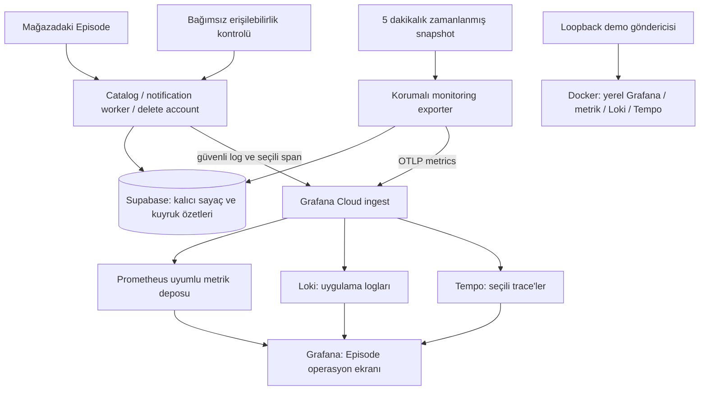

# Episode: Grafana Cloud + yerel Docker kararı

2 Kasım 2026. Kullanıcı uygulamanın mağazada olduğunu ve günlük yaklaşık 7–8 kişi tarafından kullanıldığını belirtti. Öncelik temel monitoring, API kotaları, kullanıcı sayısı ve aktiviteyi güzel bir arayüzden görmek; Grafana, Loki ve Tempo aynı zamanda DevOps öğrenme hedefinin parçası. Kullanıcı **Grafana Cloud + yerel Docker** seçeneğini seçti. Temel kullanıcı/aktivite takibi sonraki isteğiyle ilk kapsama alındı.

## Karar ve mevcut teslim

**Uygulama güncellemesi:** Backend sayaçları, OTLP exporter, güvenli log/trace, analitik intake, opt-in tercih/silme ve mobil JS event bağlantıları artık kodlandı. Canlı deployment ve Cloud hesabı bağlantısı yapılmadı. Aşağıdaki ilk taslak durumları tasarım geçmişini anlatır; güncel çalıştırma adımları ve sınırlar [kurulum rehberindedir](monitoring-setup.md).

Grafana ilk aşamada ana yönetim ekranı olacak. Loki ve Tempo da başlangıç tasarımında yer alacak. SQL Editor'e gidip günlük kontrol yapmak gerekmeyecek; veri kaynaklarını backend otomatik besleyecek. Mobil native hata takibi sonraki açıkça istenen build'e biriktirilecek.

**Grafana Cloud'un görevi:** metrics/log/trace verisini yönetilen bir ortamda saklamak, sorgulamak, dashboard ve alarm sunmak. Gerçek veriyi uygulama/backend ölçümleri üretir. Cloud hesabı açmak tek başına kullanıcı aktivitesini veya API tüketimini toplamaz. Aynı gerçek veri kendi işlettiğimiz Grafana/Loki/Tempo ortamına da gönderilebilir; Cloud seçimi bilgisayar açık kalmadan erişim ve altyapı bakımını yönetilen hizmete bırakmak içindir. [Grafana Cloud'un resmi açıklaması](https://grafana.com/docs/grafana/latest/introduction/grafana-cloud/).

Hazırlananlar:

- [22 panelli Grafana operasyon dashboard'u](../observability/grafana/episode-ops-dashboard.json).
- [16 panelli kullanıcı ve aktivite dashboard'u](../observability/grafana/episode-users-dashboard.json).
- [Yerel Docker ortamı](../observability/compose.yaml), dashboard provisioning ve [başlatma rehberi](../observability/README.md).
- Sadece loopback'e sentetik metrik, log ve trace gönderen [demo aracı](../observability/send-demo.mjs). Üretim verisi içermez.

Cloud hesabı oluşturulmadı veya bağlanmadı. Backend exporter/instrumentation, migration ve mobil JS aktivite takibi kodlandı; üretime dağıtılmadı. Cloud alarm kaynakları/contact point'leri henüz oluşturulmadı. Yerel Docker ortamı başlatıldı; iki dashboard tarayıcıda, metrik/log/trace akışı yerel kaynaklarda doğrulandı. Yerel veri açıkça sentetik `local` verisidir.

Doğrulama kapsamı: Docker Compose, dashboard JSON/yerleşim, yerel tarayıcı ve metrik/log/trace sorguları, TypeScript/ESLint, uygulama/Edge/deployment testleri, izole DB migration ve entegrasyon testleri; yerel iOS/Android Expo export. Cloud credential ile gerçek teslim ve fiziksel cihazdaki OTA kabulü hesap/dağıtım sonrasında ayrıca doğrulanacak.

## Nerede ne çalışacak?

Cloud günlük kullanım için sürekli erişilebilir paneli sağlar. Yerel lab, aynı veri sözleşmesini öğrenmek ve denemek içindir; bilgisayarın açık kalması üretim monitoring'inin önkoşulu olmayacak. Yerel arayüz ve Cloud aynı anda açık olabilir; demo `local`, gerçek backend `production` olarak ayrılır. Bu ortam etiketi OTA kanalı değildir: mevcut preview/production uygulamaları ortak backend kullanır.

Cloud'a giden metrics/log/trace yazma yetkileri server secret olarak kalır. Grafana paneline veya mobil bundle'a Supabase service-role anahtarı konmaz. Production dashboard herkesin erişebildiği public bir sayfa olmayacak.

Yerel lab başlangıçta resmi LGTM geliştirme imajıyla tek konteynerde kuruluyor. Bu, Grafana/Loki/Tempo'nun rollerini ve korelasyonu incelemeyi kolaylaştırır. DevOps pratiğinin sonraki adımı ayrı konteynerler, ayrı volume'lar, collector yapılandırması ve hata senaryoları olabilir. Üretim verisi için bu yerel demo konteyneri kullanılamaz.

## Ana ekranda ne görünecek?

Üst bölüm sayısal kartlar, ikinci bölüm kota göstergeleri, orta bölüm trend grafikleri, alt bölüm log ve trace ayrıntısı olacak. Eşiklerde yeşil/turuncu/kırmızı; eksik veride gri ve açık "veri yok" durumu kullanılacak. Sayılar ile grafiklerin anlamı panel açıklamalarında yer alır.

| Bölüm | Gösterilecek bilgi |
| --- | --- |
| Günlük genel görünüm | Katalog isteği, gerçek TMDB çağrı denemesi, başarısız istek ve son snapshot yaşı |
| OMDb | Nominal 1.000/gün kota rezervasyon yüzdesi, uygulamadaki 950/gün koruma bütçesi, güvenli kalan ve gerçek fetch denemesi |
| Tüketim trendi | Gün içinde yükselen ve sayaç dönemi değişince sıfırlanan kullanım; TMDB/OMDb ayrı |
| Tüketimin kaynağı | Kullanıcı katalog akışı ile notification worker ayrımı |
| Cache | Fresh hit, miss, stale-error ve stale-limit; cache'in kaç dış çağrıyı önlediğini değerlendirme |
| Sağlık | Katalog hatası, degraded yanıt, worker tamamlanması ve bildirim kuyruğu |
| Loki | Filtrelenebilir, güvenli JSON uygulama logları |
| Tempo | Seçilen istekte DB/cache/upstream adımlarının süresi ve sonucu |
| Sonraki kartlar | Supabase kapasite/aylık kullanım ve mobil hata/sync; gerçek veri kaynağı kurulunca |

Üst kartlar her zaman son günlük snapshot'ı gösterir. Grafikler tarih aralığına göre değişir. Panel yenilemesi cache'lenmiş metrik deposunu okur; TMDB/OMDb'ye test isteği atmaz ve kotayı harcamaz. Beş dakikalık backend snapshot günde yaklaşık 288 function çağrısı üretir; bu, sağlayıcı kotası değil Supabase tarafında ayrıca ölçülecek monitoring yüküdür.

## Kotaların doğru anlamı

| Servis | Gösterilecek bütçe | Doğruluk sınırı |
| --- | --- | --- |
| OMDb Free | Resmi plan 1.000/gün; kodun koruma sınırı 950/gün | Bizim rezervasyonumuz, bizim fetch denememiz ve sağlayıcının gerçek hesabı aynı şey değildir. Aynı key başka yerde kullanılıyorsa yalnızca uygulama sayacından tam kalan hesaplanamaz. |
| TMDB | Günlük çağrı sayısı, anlık hız, 429 ve hata | Resmi doküman sabit günlük limit vermiyor; yaklaşık 40 istek/sn civarı değişebilen koruma belirtiyor. Günlük "kalan yüzde" uydurulmaz. |
| Supabase | DB/Storage boyutu ve egress/Edge/Auth gibi kendi dönemindeki kullanımlar | Toplam API istekleri için Free plan günlük adet kotası yok. Aylık/project/organization kapsamı doğru seçilmeli. |
| Grafana Cloud | Aktif metric series, log/trace ingest ve retention | Monitoring'in kendisi de quota panelinden izlenmeli; uygulama kullanıcı sayısı Grafana panel kullanıcı sayısı değildir. |
| Expo | EAS Update veya build kullanımının kendi dönemi | 30 Ekim'deki iki build hakkı bilgisi Kasım kotası olarak taşınmaz; güncel hesap verisi gerekir. |

Kaynaklar: [OMDb Free](https://www.omdbapi.com/apikey.aspx), [TMDB rate limiting](https://developer.themoviedb.org/docs/rate-limiting), [Supabase planları](https://supabase.com/pricing).

Supabase Free fiyat sayfasında örneğin DB 500 MB, dosya depolama 1 GB, egress 5 GB ve cached egress ayrı 5 GB olarak listeleniyor. Bu kotalara göre kartlar hazırlanabilir; kullanım değeri gerçek muhasebe kaynağından gelmeli. Response byte toplamı sağlayıcının egress faturası yerine konmaz. Erişilebilir ve doğrulanmış usage API'si yoksa kart "bağlı değil" gösterir; tahmin kesin tüketim gibi sunulmaz.

Kota sayaçlarının günü ve sıfırlanması açıkça gösterilmeli. Şu anki `current_date` tabanlı günlük verinin DB timezone'u ile sağlayıcı reset zamanı doğrulanacak. İstanbul saatinde grafik göstermek sayaç gününü İstanbul'a dönüştürmez. Geçmişte farklı kapsamla tutulmuş kayıtlar tamamlanmış veri gibi yeniden adlandırılmayacak.

## Veri toplama: ücretsiz planla nasıl yapılacak?

### Metrikler

Öncelikle mevcut kalıcı günlük sayaçlar tamamlanır. Katalog inbound, gerçek upstream denemesi, rezervasyon ve sonuç birbirinden ayrılır; worker tüketimi eklenir. Bunlar process içi sayaç olmaz: Edge instance yeniden başladığında toplam sıfırlanmamalı. Kota korumasının atomik rezervasyonu ve 950 sınırı korunur.

Korumalı exporter sabit aggregate sorgularıyla veriyi alır. Server tarafındaki zamanlanmış görev beş dakikada bir bu snapshot'ı Cloud OTLP endpoint'ine gönderir. Panel okuyucusu DB anahtarı almaz ve SQL çalıştırmaz. Sorgular limitli ve indekslere uygun olur; sadece monitoring nedeniyle her log kaydı üretim DB'sine yazılmaz.

Dashboard sözleşmesi aşağıdadır. Exporter ve yerel demo bu adları üretir; production verisi backend dağıtımı sonrasında gelir. `today` alanları exporter'ın bildirdiği günlük dönem içinde gauge'dur. Bu gauge'lara `rate()` uygulanmaz. `environment` backend ortamı, `source` yalnızca `catalog/notification_worker` gibi sınırlı değerlerdir.

| Metrik ailesi | Anlam |
| --- | --- |
| `episode_telemetry_snapshot_timestamp_seconds` | Gerçek verinin başarıyla toplandığı zaman; başarısız toplamada yenilenmez |
| `episode_catalog_requests_today` | Handler'a ulaşan uygun katalog istekleri; cihaz cache hit'leri veya gateway'de reddedilenler dahil değil |
| `episode_catalog_errors_today` | Kullanıcıya başarısız sonuç veren katalog isteği; stale başarı ayrı |
| `episode_provider_daily_quota_limit` | Sağlayıcı için doğrulanmış nominal günlük limit; TMDB için seri üretilmez |
| `episode_provider_daily_safety_limit` | Uygulamanın kendi koruma bütçesi |
| `episode_provider_budget_reserved_today` | Kota rezervasyonları; provider boyutuyla |
| `episode_provider_request_attempts_today` | Gerçek ağ/fetch denemeleri; provider ve source boyutlarıyla |
| `episode_catalog_cache_responses_today` | Karşılıklı dışlayan hit/miss/stale sonuçları; upstream hata sayacıyla toplanıp yeni bir istek toplamı üretilmez |
| `episode_worker_last_completed_timestamp_seconds` | Worker'ın handler tamamlanması; tüm alt işlerin başarılı olduğu ayrıca izlenir |
| `episode_worker_last_run_scan_errors` | Son tamamlanan çalışmanın scan hata sayısı |
| `episode_notification_queue_pending` | Uygun pending/processing teslimlerin sayısı; gönderilmiş receipt bekleyenlerden ayrı |
| `episode_notification_queue_oldest_age_seconds` | Uygun kaydın ilk enqueue zamanından yaşı; `next_attempt_at` değildir |

`provider` ve `source` ayrımıyla aynı kullanım iki kez toplanmamalı. Snapshot toplama veya Cloud gönderimi başarısızsa eski veriye yeni zaman verilmez. Sıfır trafik, eksik veri ve eski snapshot farklı durumlardır. Ayrıntılı latency histogramları ve tüm backend/gateway istekleri bu ilk taslağın dışında ek sinyallerdir; mevcut panel toplam uygulama kullanımını ölçtüğünü iddia etmez.

### Log ve trace

Supabase Free'de hazır Log Drains yok. Resmi ücretli aktarım Pro ve üzerinde ek ücretli olduğundan sırf bu amaçla plan yükseltmek önermiyorum. Kendi Edge Function'larımız, request ID ve trace ID içeren güvenli logları/izleri OTLP ile Cloud'a gönderecek. Collector veya uygun SDK ile sinyal formatı, kapsam izolasyonu ve runtime kapanışı doğrulanacak.

Bu yolla function içindeki kendi uygulama loglarımız Loki'de olur. Supabase gateway, Auth ve PostgreSQL platform loglarının tamamı otomatik gelmez. Bu kapsam sınırı panelde korunur. [Supabase Log Drains](https://supabase.com/docs/guides/observability/log-drains).

Trace örneği: `catalog.request → cache.lookup → usage.reserve → tmdb.fetch → cache.write`. Veriler handler'daki süreleri kapsar; istemcinin mobil render ve ağ süresi ayrıca instrument edilmedikçe görünmez. Kota metrikleri örneklenmez; trace'ler sınırlı örneklenir. Bir hata event'ini tam toplamak, önceden örneklenmeyen trace'i geriye dönük oluşturmaz.

Token, authorization, ham arama, yorum ve izleme listesi gönderilmez. Trace ID Loki label'ı yapılmaz; log alanı/metadata olur. Küçük sabit label'larla Loki seri sayısı kontrol edilir. Logdan trace'e geçiş, Loki datasource derived field üzerinden Tempo'ya bağlanır.

## Kullanıcı sayısı ve aktivite: ilk kapsama eklendi

Kullanıcı bu verileri de görmek istediğini belirtti. Temel kullanıcı/aktivite kartları ilk kapsamdadır; ayrıntılı funnel, retention analizi veya deney platformu ayrıca değerlendirilebilir. İlk aşamada yeni bir analitik SaaS eklemek zorunlu değil: sınırlı event'ler backend'de tekilleştirilip Grafana'ya toplu sayılar gönderilebilir.

| Gösterge | Ölçüm tanımı |
| --- | --- |
| Kayıtlı hesap | Silinmemiş profili olan hesaplar. `profiles`, Auth kullanıcı oluşturma trigger'ıyla oluşuyor; bu sayı tek başına e-posta onaylı hesap veya mağaza indirmesi değildir. |
| Bugün yeni hesap | Europe/Istanbul takvim gününde oluşturulmuş ve hâlâ mevcut profiller. Silinmiş kayıtları da içeren brüt kayıt sayısı istenirse ayrıca server event geçmişi gerekir. |
| DAU | Bugün foreground açılış veya geçerli etkileşimi gözlenen farklı hesaplar. Aynı hesabın çoklu cihazları bir kişi sayılır. |
| WAU / MAU | Son 7 / 30 günde aktif olan farklı hesaplar. Günlük sayıların toplamı alınmaz. |
| Son 15 dakika aktif | Son 15 dakikada önde olduğu gözlenen hesaplar; snapshot gecikmesiyle yaklaşık gösterge. "Şu an kesin online" değildir. |
| Oturum | Ürün oturumu; 30 dakikalık aradan sonra yeni oturum. Kalıcı Supabase Auth session'ı ile karıştırılmaz. |
| Gözlenen önde süre | AppState foreground segmentlerinin toplamı; background ve gerçek film/dizi izleme süresi değildir. |
| Özellik kullanımı | Arama, detay açma, kütüphaneye ekleme, bölüm işaretleme işlemi, yorum, arkadaş isteği, watch-wheel ve bildirim açma sayıları. |

Backend'de toplam/mevcut hesap ve oluşturulma tarihine göre sayım mobil güncelleme olmadan alınabilir. Gerçek DAU, oturum, ekran ve cache'ten karşılanan etkileşimler için mobil event gerekir. Mevcut kodda AuthProvider, AppState ve Expo Router var; bunlar sınırlı bir JS event adapter'ının toplama noktaları olabilir.

API isteğini kullanıcı aktivitesi yerine koymayız. Retry, notification worker ve token yenilemesi insan etkileşimi değildir. Kalıcı Auth oturumu yeni giriş yapmadan günlerce kullanılabilir. Diğer taraftan cihaz cache'i nedeniyle uygulamayı kullanan kişi hiç katalog isteği üretmeyebilir.

Önerilen akış: `AppState / ekran / açıkça tanımlanmış eylem → sınırlı yerel event kuyruğu → JWT doğrulayan analytics intake → günlük tekilleştirilmiş özetler → exporter → Grafana`. Kullanıcı kimliği istek body’sinden güvenilerek alınmaz; doğrulanan oturumdan türetilir. Oturum/kullanıcı bağlamı hesap değişiminde temizlenir.

Her mantıksal event bir kez üretilen `event_id` taşır; retry/sync tekrarında aynı kimlik kullanılır. Sunucu dedupe ve sayaç güncellemesini atomik uygular; olay yeniden gelirse ikinci kez saymaz. Toplu bölüm işaretlemesi bir kullanıcı işlemidir; değişen bölüm adedi ayrı `item_count` olarak ölçülebilir. Yerel etkileşim ile sunucunun iş değişikliğini onaylaması farklı başarı sinyalleridir.

Foreground süreleri monotonik saatle segment bazında hesaplanır; background/hesap değişiminde kapatılır. Crash veya kapanışta son event kaybolabileceği için süreler "gözlenen" olarak etiketlenir. Yakın dönem presence için yalnızca foreground ve güncel sinyal kullanılır; eski offline event'in yeni alınması kullanıcıyı şu an aktif göstermez. Event oluşma ve alınma zamanı ayrılır; clock sapması, geç gelen veri ve izin verilen geçmiş pencere server tarafında sınırlandırılır.

İlk depolama küçük bir `user_activity_daily` özeti ve idempotency için süreli event receipt kayıtları olabilir. Ham her dokunuş/render veya tüm kullanıcı içeriği tutulmaz. WAU/MAU için gerektiği kadar günlük, kullanıcı bazında tekilleştirme verisi backend'de tutulur; Grafana'ya yalnızca aggregate sayılar gider. Kimlikler Prometheus/Loki label'ı yapılmaz. Retention, analitik tercihi ve hesap silmede kimliğe bağlı verinin kaldırılması toplama endpoint'iyle birlikte uygulanır.

### Kullanıcı dashboard metrik sözleşmesi

| Metrik ailesi | Boyut / anlam |
| --- | --- |
| `episode_user_activity_snapshot_timestamp_seconds` | Kullanıcı özetinin gerçekten başarıyla toplandığı zaman; kota snapshot'ından bağımsız |
| `episode_users_registered` | Mevcut profil sayısı |
| `episode_users_new_today` | Bugün oluşturulan mevcut profil sayısı |
| `episode_users_active` | `window=day/7d/30d/15m`; her pencere backend'de distinct hesaplarla hesaplanır |
| `episode_user_sessions_today` | `platform=ios/android/...`; günlük başlayan ürün oturumları, platform üzerinden toplanabilir |
| `episode_user_foreground_seconds_today` | Bugünün toplam gözlenen foreground süresi |
| `episode_user_events_today` | Sabit `event` allowlist'iyle mantıksal etkileşim sayıları; kullanıcı/medya kimliği boyutu yok |

Bu adlar deployment sonrasında gerçek snapshot'lardan üretilecek. [16 panelli kullanıcı dashboard'u](../observability/grafana/episode-users-dashboard.json) bu sözleşmeyi kullanır; yerel demo toplam 22 metrik ailesi üretir. İlk 30 günde, eski app sürümlerinde veya analitik katılımı kapalı hesaplarda aktivite kapsamı kısmidir. Veri toplamaya başlanmadan önceki gerçek kullanım geriye dönük oluşturulmaz. Yeni uygulama sürümü görünür etkileşim sayısını artırabilir; bu doğrudan kullanıcı büyümesi diye yorumlanmaz.

Temel mobil event adapter'ı mevcut bağımlılıklarla JS olarak kuruldu; native bağımlılık eklenmedi. Yayından önce hedef runtime/kanal ve etkilenen mağaza kurulumları doğrulanır. Native crash SDK'sının build gereksinimi bundan ayrıdır. Mobil kod hazır; OTA veya native build yayımlanmadı. [Expo runtime uyumluluğu](https://docs.expo.dev/eas-update/runtime-versions/).

## Cloud bütçesi, geçmiş ve küçük trafik

İncelenen Grafana Cloud Free planı 10.000 aktif metric series, ayda 50 GB log, 50 GB trace, 14 gün retention ve üç aktif Grafana kullanıcısı içeriyor. Episode'un günlük 7–8 kullanıcısı bu üç panel kullanıcısı limitini tüketmez. Bu hacimde ücretsiz katmanda kalmayı hedeflemek makul; gerçek series/ingest izlenerek doğrulanır. [Güncel Grafana planları](https://grafana.com/pricing/).

14 günlük retention, örneğin 30 günlük detaylı grafik için yeterli değildir. İlk dashboard 24 saat/7 gün/14 gün görünümünde kullanılabilir. Daha uzun günlük kota geçmişi istenirse backend'de zaten tutulan günlük özetlerin güvenli read-only sorgu/export kaynağı aynı Grafana paneline ayrıca bağlanır. Prometheus'a geçmiş günler current sample gibi yazılıp sahte geçmiş üretilmez. Her 30 günlük seçimin otomatik dolacağı vaat edilmez.

Az trafikte saatlik p95 veya hata yüzdesi çok az örneğe dayanabilir. Bu nedenle ana görünümde gerçek adetler, son hata, snapshot yaşı, kuyruk ve günlük kota önde olacak. Sonraki performans grafikleri örnek sayısını da gösterecek.

İlk alarmlar: bağımsız readiness başarısızlığı, snapshot gelmemesi, worker ilerlememesi, uygun push kuyruğunun yaşlanması, OMDb koruma bütçesinin %70/%85'inin aşılması ve yeni ciddi hata. 1.000 nominal kota ile 950 güvenlik bütçesi yüzdeleri alarm metninde karıştırılmaz. Alarm bildirimi hedefi ve Cloud hesabının özellikleri kurulumda doğrulanacak.

## Sonraki uygulama sırası

1. Yerel lab'da dashboard, Loki logu ve Tempo trace görünümünü doğrula. Demo `local` olarak kalır.
2. Grafana Cloud'da aynı paneli içe aktar; metrics/logs/traces veri kaynaklarını seç. Üretim ingest yetkilerini yalnızca server secret olarak tanımla.
3. Backend sayaçlarını tamamla; korumalı snapshot/exporter, hesap sayımı, enqueue zamanı ve worker completion kaydını uygula. Mevcut iş mantığı, Edge ve DB kontrollerinden etkilenenleri çalıştır.
4. Backend entegrasyonunu kontrollü deploy et; gerçek panel verisini mevcut DB özetleriyle bir kez karşılaştır. Eksik/sıfır/eski veri alarmlarını doğrula. Günlük kullanım bundan sonra UI'dan yapılır.
5. Seçili log/trace gönderimini ve Loki→Tempo geçişini aç; telemetry'nin asıl istek sonucunu etkilemediğini kontrol et.
6. Temel JS kullanıcı/aktivite event adapter'ı, doğrulanan intake, idempotent özetler ve veri tercihi/silme kapsamını uygula. Native değişiklik yoksa uyumlu runtime/kanala OTA adayı olarak doğrula.
7. Mobil native hata ve native performans kapsamını sonraki kullanıcı onaylı native build'e dahil et.

Cloud hesabı, canlı migration/function deploy'u, OTA veya EAS/native build çalıştırılmadı. Kodlanan backend/JS entegrasyonu ve çalışan yerel lab, Cloud hesabı hazır olduğunda [kurulum rehberine](monitoring-setup.md) göre bağlanacak.
